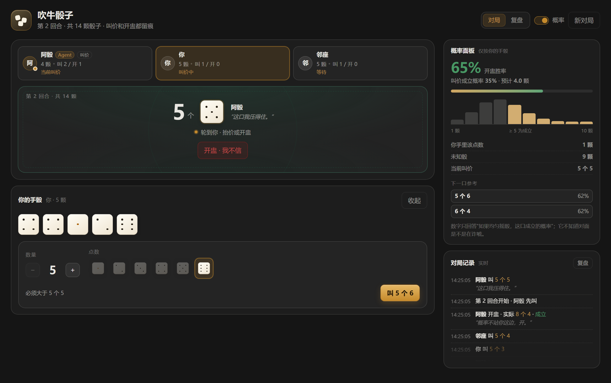
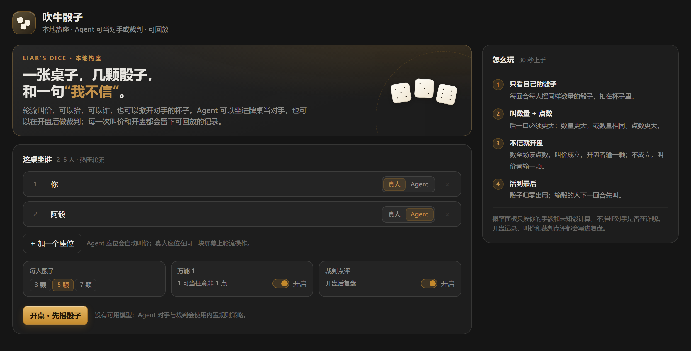
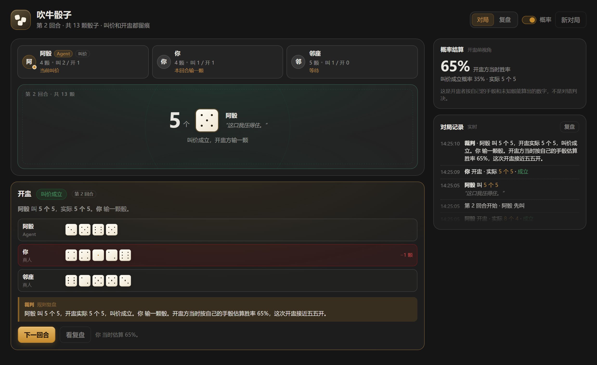
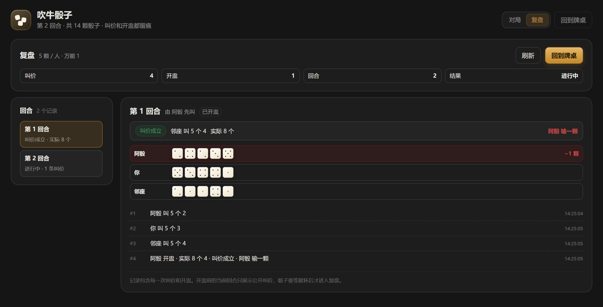

# dsh-liars-dice

[](https://github.com/dingchenhui0618-arch/dsh-liars-dice/actions/workflows/ci.yml)
[](LICENSE)

中文吹牛骰子（Liar's Dice）的 DSH 插件：本地多人轮流叫价，Agent 可以坐进牌桌当对手，也可以在开盅后做裁判；每一次叫价和开盅都进入可回放的记录，概率面板随时可以关掉。



## 它是什么

- **2–6 人热座对局**：同一块屏幕上轮流操作，每人 3 / 5 / 7 颗骰子可选。
- **Agent 对手**：有可用模型时走模型，返回 JSON 动作并在服务端按规则校验；模型不可用、超时或给出非法动作时，自动退回内置的概率策略。
- **Agent / 规则裁判**：开盅后读取全场牌面，给一句 2–3 句的复盘；没有模型时用确定性的规则文案。裁判只点评，**不改判**——输赢永远由服务端规则决定。
- **可回放记录**：按回合分组，叫价、开盅、裁判点评都在里面；当前回合未开盅时，骰子仍对回放接口保密。
- **可关掉的概率面板**：精确二项分布，给出开盅胜率、叫价成立概率、预计总数、分布条和下一口参考。

它不试图复刻斗地主 / 德州那类完整规则牌类。这个项目想验证的是另一种交互：**读人、诈唬，以及 Agent 的叫价行为能不能被回看**。

> 本项目是独立实现，没有复制现成的吹牛骰子代码，也没有引用或 fork 其他骰子插件。工程骨架（零依赖构建、`cordis.patch.yml`、host/client 两半、CI、测试结构）参考了 [dsh-warden](https://github.com/dingchenhui0618-arch/dsh-warden)。插件市场是否已有同类项目，本项目没有做全量检索，因此不作断言。

## 安装

目前从 GitHub 或本地目录安装，**尚未发布到 npm**。

```sh
dsh plugin --profile <你的 profile> add github:dingchenhui0618-arch/dsh-liars-dice
```

或从本地工作区：

```sh
dsh plugin --profile <你的 profile> add D:\Projects\dsh-liars-dice
```

装好后重启 DSH，对话视图里会出现「吹牛骰子」Tab。桌面端在应用内安装插件时，profile 由应用自己管理，不需要手敲上面的命令。

## 怎么玩

1. **开桌**：选 2–6 个座位，每个座位标成「真人」或「Agent」；选每人骰子数、是否开启万能 1、是否要裁判点评。
2. **翻手骰**：轮到你时点「翻开手骰」，看完再决定叫价。换人时视角会盖回去。
3. **叫价**：后一口必须更大——数量更大，或数量相同、点数更大。例如 `3 个 4` 之后可以叫 `4 个 4` 或 `3 个 5`。
4. **开盅**：觉得对面在吹，就点「开盅 · 我不信」。全场该点数一数，叫价成立则开盅者输一颗，不成立则叫价者输一颗。
5. **出局与获胜**：骰子归零出局，输骰的人下一回合先叫；最后还有骰子的人赢。

默认开启**万能 1**：1 可以当任意非 1 的点数；但叫「1 个 1」时只数真的 1。关闭后 1 只算 1。

## 界面

### 开桌

座位、骰子数、万能 1、裁判点评都在这里；右侧是 30 秒规则卡。



### 开盅与裁判

开盅后展示所有手骰、实际点数、输家、开盅前的赔率，以及裁判点评。



### 复盘

回合列表 + 完整叫价/开盅流水；已开盅的回合会显示所有手骰，当前回合只展示公开叫价。



> 截图来自**真实的 client 组件和真实的 host 路由**。为了取景，外层套了一个本地预览壳，不是 DSH 桌面壳本身；`_preview/` 是本地临时目录，不入库。

## 概率面板

面板只回答一个问题：**如果未知骰均匀摇，这口叫价成立的概率是多少？** 它不推断对手是否在诈唬。

- 每个未知骰匹配当前点数的概率：非 1 面在万能 1 下是 `1/3`，叫 1 时是 `1/6`；关闭万能 1 后都是 `1/6`。
- 用二项分布精确计算「总数 ≥ 叫价数量」的概率，再做尾概率，不采样、不近似。
- 同时显示开盅胜率、叫价成立概率、预计总数和完整分布条。
- 「下一口参考」会从合法叫价里挑 3 个不同数量的候选，按 `数量 × 成立概率` 排序后从低到高展示；它不是胜率承诺，只是把概率摆出来。
- 面板只在**真人回合**、且该真人能看到自己手骰时计算；Agent 回合会显示「对手的骰子不进入计算」。
- 热座隐私：**先翻开手骰，赔率才出现**；点「收起」后面板也会盖回去，避免把这一手的信息直接摊给旁边的人。
- 标题栏的「概率」开关可随时关掉，偏好记在 `localStorage`。

## Agent 的数据边界

- **对手**：prompt 只包含自己的手骰、公开的存活人数 / 骰子数、最近的公开叫价与开盅、当前合法叫价。**不包含其他玩家的手骰。**
- **裁判**：只在开盅后读取全场牌面、叫价历史和开盅者当时的赔率；要求 2–3 句中文，只做复盘。
- **规则是权威**：模型返回的动作必须通过服务端合法性校验；模型可以诈唬，但不能改规则、不能跳过回合、不能伪造开盅结果。
- **降级**：没有模型、模型报错、超时（对手 15s / 裁判 12s）、输出无法解析或动作非法——对手退回概率策略，裁判退回规则文案。面板不会因此卡住。

## 运行时与卸载

- Host 在 `ctx.effect()` 里注册 `/dsh-liars-dice` 前缀路由，并持有 disposer；卸载时清空内存牌桌。
- Client 在 `ctx.effect()` 里插入 `<style>`，并在卸载时移除；共享轮询计时器活在模块作用域，有独立的清理路径，不依赖 React 卸载。
- 面板注册失败（宿主没有 `webServer` 或契约变化）不会让插件崩溃，只是没有 Tab。

## 开发

零运行时依赖，构建脚本只用 Node 内置模块：

```sh
node scripts/build.mjs     # src/ -> lib/，内联 CSS，并做 host 导出校验
node --test test/*.test.mjs # 54 个测试
node scripts/pre-push-check.mjs # 密钥 / .gitignore / 临时文件三项检查
```

测试分四组：

| 文件 | 覆盖 |
| --- | --- |
| `test/odds.test.mjs` | 二项分布、万能 1、尾概率、期望值 |
| `test/game.test.mjs` | 发牌、合法叫价、开盅、淘汰、回放脱敏、概率建议 |
| `test/bot.test.mjs` | 规则对手、prompt 边界、JSON 解析、裁判降级文案 |
| `test/host.test.mjs` | 真实 `apply()` + stub ctx：路由、锁、LLM 校验、降级、卸载、多桌隔离 |

`lib/` 是入库的构建产物；改 `src/` 后必须重新 build，否则 CI 的 `lib/ matches src/` 会失败。CI 在 Ubuntu / Windows × Node 22 / 24 上跑构建、产物一致性和全部测试。

## 它不做什么

- **不是在线房间**：没有账号、匹配、服务器托管或跨设备同步；牌桌只在当前 host 进程内存里，重启归零。
- **不是防作弊客户端**：热座模式下，当前真人的手骰会发给浏览器（翻开后才显示）；同一页面上的开发者工具仍然能看到。它防的是“不小心看到”，不是“存心作弊”。
- **路由没有额外鉴权**：依赖 DSH web server 自身的访问控制；能访问本机 DSH 页面的人就能操作这张牌桌。
- **裁判可能说错**：模型点评是 commentary，不是判决；输赢、淘汰和回放以服务端规则为准。
- **没有音效和动画**：视觉反馈靠状态、颜色和记录，不靠动效。

## License

MIT
